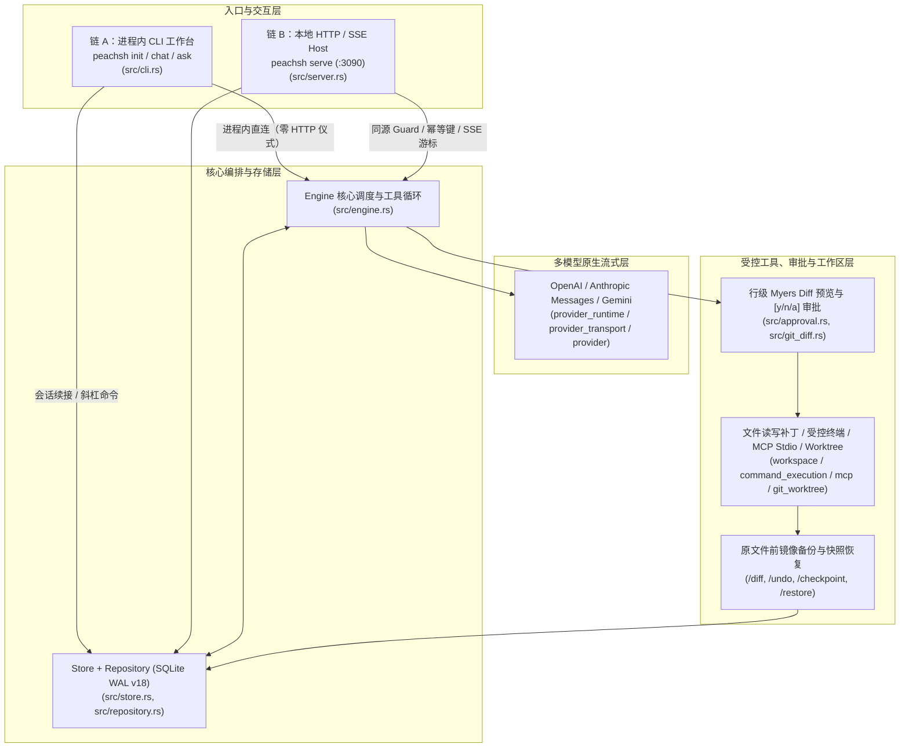

# NoHumanCode 项目地图 (PROJECT-MAP)

> **定位**：本文档是 **NoHumanCode** 仓库唯一的现行全局导航、架构拓扑与源码模块索引（Living Project Map）。新协作者或 AI Agent 进入仓库后，请先阅读 [AGENTS.md](AGENTS.md) 了解工程准则，再通过本文档定位模块边界、执行调用链与测试矩阵。

---

## 1. 基线快照与仓库拓扑

### 1.1 当前工程基线（2026-11-18）

| 维度 | 当前事实 |
| :--- | :--- |
| **Git 根目录与主分支** | `./`（分支 `main`） |
| **阶段交付里程碑** | **Stage 1：Windows 本机优先的 CLI AI 编程工作台**已完整交付；图形界面（Desktop GUI）明确延后至第二阶段 |
| **Rust Workspace** | [NoManCode/rust-app](NoManCode/rust-app)（宿主包与二进制兼容标识 `peachsh`，共享协议包 `peachsh-protocol` 位于 [crates/protocol](NoManCode/rust-app/crates/protocol)） |
| **SQLite Schema 版本** | `SCHEMA_VERSION = 18`（WAL 模式、事件溯源 + 状态投影、幂等回执与中断自动恢复） |
| **Rust 代码规模** | 共 **42,212 行** Rust 代码：`src/*.rs`（38 个文件，33,427 行）、`crates/protocol/src/lib.rs`（1 个文件，363 行）、`tests/**/*.rs`（17 个文件，8,422 行） |
| **质量门禁状态** | `cargo fmt --check`、`cargo clippy --workspace --all-targets -- -D warnings`、`cargo test --workspace`、`cargo build --release` 全部 100% 绿灯通过 |
| **已清理的历史包袱** | 空壳 `crates/ui`（Leptos 迁移壳）、死代码 `src/wasm*`（WASM 沙箱）、伪插件金字塔 `plugin_catalog.rs` / `plugin_host.rs`、以及旧多角色文书目录 `niuma/` 均已从 `main` 移除 |
| **历史归档分支** | 早期多 Agent 协作记录与阶段性分支完整归档保留在 Git 分支：`archive/gpt-era-20261118`、`archive/old-c35-20261118`、`archive/u18-consolidated-20261118` |

### 1.2 顶层目录结构

```text
./                                  # Git 仓库根目录
├── README.md                       # 快速开始、CLI 命令速览与核心特性介绍
├── AGENTS.md                       # 核心工程准则与构建/验证命令
├── PROJECT-MAP.md                  # 现行项目地图：架构主链、源码模块全景与测试矩阵（本文档）
├── PROJECT-BOOK.md                 # 长期产品理念、领域边界与架构演进背景
├── CONTRIBUTING.md                 # 协作与提交流程简明指南
├── NoManCode/                      # 自有源码与运行脚本工作区（保留目录拼写兼容）
│   ├── README.md                   # NoManCode 源码区结构与脚本说明
│   ├── AGENTS.md                   # NoManCode 子目录开发指引
│   └── rust-app/                   # 核心 Rust Workspace（peachsh + peachsh-protocol）
│       ├── Cargo.toml              # Workspace 与依赖定义（Rust Edition 2024）
│       ├── build.ps1               # Windows MSVC/SDK 自动探测与构建/检查/测试入口脚本
│       ├── crates/protocol/        # 前后端/客户端零 I/O 共享协议类型（peachsh-protocol）
│       ├── src/                    # Host 核心、CLI 工作台、多模型传输、工具与存储（38 个模块）
│       ├── tests/                  # 端到端与子系统集成测试矩阵（13 个测试目标 + 4 个夹具模块）
│       └── web/                    # server.rs 内嵌兜底的轻量级静态 HTML/JS 页面（非主开发方向）
└── references/                     # 外部架构与同类 AI 编程工具参考资料
```

---

## 2. 核心架构与两条执行主链

NoHumanCode 以单一进程内的 `Store`（SQLite 持久化中心）与 `Engine`（生命周期、工具循环与并发调度核心）为底座，向上提供**两条清晰分离的执行主链**：



### 2.1 链 A：零仪式感进程内 CLI 工作台链（主力日常入口）

面向开发者终端日常高频编码，无需预先启动后台守护进程：

1. **命令入口与会话绑定**：用户运行 `peachsh init`、`peachsh chat` 或 `peachsh ask`（支持零初始化环境变量 `OPENAI_API_KEY` / `ANTHROPIC_API_KEY` / `GEMINI_API_KEY` 开箱即用，或通过 `-c` / `--continue` / `--resume <id>` 恢复多轮上下文）。
2. **上下文展开与环境感知**：[cli.rs](NoManCode/rust-app/src/cli.rs) 解析提问中的 `@file`、`@file:start-end`、`@dir/` 内联引用，拼装行号上下文；自动注入系统环境、Git 仓库状态、项目级 `AGENTS.md` / `CLAUDE.md` 规范，并从 `.mcp.json` / `.nhc/mcp.json` 发现注册本地 Stdio MCP 工具（[mcp.rs](NoManCode/rust-app/src/mcp.rs)）。
3. **进程内直连编排**：CLI 在当前进程直接挂载 `Store` 与 `Engine`，省去本地回环 HTTP 序列化开销；长对话支持按原子工具调用组自动或手动压缩（`/compact`）。
4. **多协议原生流式推理**：经 [provider_runtime.rs](NoManCode/rust-app/src/provider_runtime.rs) -> [provider_transport.rs](NoManCode/rust-app/src/provider_transport.rs) -> [provider.rs](NoManCode/rust-app/src/provider.rs) 原生分流 **OpenAI Chat Completions**、**Anthropic Messages（含 Extended Thinking）** 与 **Google Gemini `streamGenerateContent`**，实时流式渲染思维链、正文增量与工具调用，并精确统计每轮 Token 用量（[provider_usage.rs](NoManCode/rust-app/src/provider_usage.rs)）。
5. **行级 Diff 预览与单键审批**：涉及文件修改、终端命令或外部 MCP 调用时，由 [approval.rs](NoManCode/rust-app/src/approval.rs) 与 [git_diff.rs](NoManCode/rust-app/src/git_diff.rs) 在终端即时渲染彩色 Myers Unified Diff，提供单键 `[y/n/a]`（允许本次 / 拒绝 / 本会话自动允许）交互审批（或 `-y` 自动放行）。
6. **受控执行、前镜像备份与随时回滚**：[workspace.rs](NoManCode/rust-app/src/workspace.rs)、[command_execution.rs](NoManCode/rust-app/src/command_execution.rs)（Windows JobObject 子进程树生命周期管控）与 [mcp.rs](NoManCode/rust-app/src/mcp.rs) 执行具体动作。每次写入前自动持久化原文件备份，随时可通过 `/diff`、`/undo`、`/checkpoint`、`/restore` 审阅与精确回滚。

### 2.2 链 B：本地 HTTP / SSE Host 服务链（脚本与未来客户端契约）

面向自动化脚本、外部集成以及未来第二阶段桌面客户端的稳定本地服务边界：

1. **服务启动与单实例锁**：运行 `peachsh serve`（或无子命令直接执行 `peachsh --port 3090`），在 [main.rs](NoManCode/rust-app/src/main.rs) 中获取数据目录单实例锁并监听 `127.0.0.1:3090`。
2. **传输层安全与幂等契约**：[server.rs](NoManCode/rust-app/src/server.rs) 实施本机 Host/Origin/Sec-Fetch-Site 同源校验、启动会话令牌鉴权、`Idempotency-Key` 持久化回执重放以及 SSE 事件流断线游标校验（`Last-Event-ID` / `after`）。
3. **事件溯源与中断恢复**：[engine.rs](NoManCode/rust-app/src/engine.rs) 与 [store.rs](NoManCode/rust-app/src/store.rs) 在 SQLite WAL（`SCHEMA_VERSION = 18`）中原子写入领域模型（Project / Session / Turn / Agent / Task）与事件流；若进程异常退出，下次启动自动将未完成任务收敛标记为 `interrupted`，绝不伪造完成状态。

---

## 3. Rust 源码模块全景表

以下完整覆盖 `NoManCode/rust-app/src/` 下的 **全部 38 个源码文件** 以及 `crates/protocol` 共享协议包。

### ① 入口与交互层（5 个文件）

| 模块文件 | 职责摘要 | 当前状态 |
| :--- | :--- | :--- |
| [src/main.rs](NoManCode/rust-app/src/main.rs) | 二进制入口、全局 CLI 参数解析、数据目录单实例锁、Tokio 多线程运行时生命周期与优雅退出控制 | 稳定运行 |
| [src/lib.rs](NoManCode/rust-app/src/lib.rs) | `peachsh` 库顶层模块导出清单与可见性边界声明 | 稳定运行 |
| [src/cli.rs](NoManCode/rust-app/src/cli.rs) | 进程内交互式 CLI 工作台核心（`init`/`chat`/`ask`/`serve` 及管理子命令）、`@file`/`@dir/` 上下文展开、REPL 斜杠命令、彩色流式与 Diff 终端渲染 | Stage 1 主力入口 |
| [src/server.rs](NoManCode/rust-app/src/server.rs) | Axum 本地 HTTP API 与 SSE 事件流服务、同源与鉴权 Guard、幂等回执重放及内嵌 `web/` 兜底路由 | 稳定契约 |
| [src/credential_input.rs](NoManCode/rust-app/src/credential_input.rs) | 安全的终端隐藏回显密钥输入（Windows Console 模式控制）与重定向管道凭据读取校验 | 稳定运行 |

### ② 核心编排与领域存储层（7 个文件）

| 模块文件 | 职责摘要 | 当前状态 |
| :--- | :--- | :--- |
| [src/domain.rs](NoManCode/rust-app/src/domain.rs) | 核心领域模型定义（`Settings`、`Route`、`Run`、`TaskSpec`、依赖无环图校验、路径范围与输入合法性验证） | 稳定核心 |
| [src/engine.rs](NoManCode/rust-app/src/engine.rs) | 任务生命周期调度器、全局/单 Key 并发信号量、多轮 Agent 工具调用循环、上下文预算管理、取消与续跑控制 | 稳定核心 |
| [src/store.rs](NoManCode/rust-app/src/store.rs) | SQLite WAL 存储底座（`SCHEMA_VERSION = 18`）、平滑 Schema 迁移、事务提交、SSE 事件游标读取、幂等键与崩溃中断恢复 | 稳定核心 |
| [src/repository.rs](NoManCode/rust-app/src/repository.rs) | 结构化领域仓储层（Project / Session / Turn / Agent / Checkpoint 等实体的持久化读写与状态投影对齐） | 稳定核心 |
| [src/execution_authority.rs](NoManCode/rust-app/src/execution_authority.rs) | 任务执行授权令牌与状态迁移门禁，确保写操作与工具副作用仅在合法运行周期内落盘 | 稳定核心 |
| [src/checkpoint.rs](NoManCode/rust-app/src/checkpoint.rs) | 工作区文件快照检查点（Checkpoint）领域结构与恢复元数据定义 | 稳定运行 |
| [src/workspace_changes.rs](NoManCode/rust-app/src/workspace_changes.rs) | 单轮/跨轮已修改文件追踪记录、变更摘要聚合与 `/undo` 回滚索引辅助 | 稳定运行 |

### ③ 多模型协议与预算网络层（8 个文件）

| 模块文件 | 职责摘要 | 当前状态 |
| :--- | :--- | :--- |
| [src/provider.rs](NoManCode/rust-app/src/provider.rs) | 三大协议原生流式编解码器：OpenAI Chat Completions、Anthropic Messages（含 Thinking 块）与 Google Gemini 流式解析及模型列表/New API 额度查询 | 稳定运行 |
| [src/provider_transport.rs](NoManCode/rust-app/src/provider_transport.rs) | 上游 HTTP 客户端连接管理、协议自适应路由分发、请求头鉴权组装与流式响应管道连接 | 稳定运行 |
| [src/provider_runtime.rs](NoManCode/rust-app/src/provider_runtime.rs) | 模型推理运行时封装：将会话历史、System Prompt 与动态工具集组装为对应厂商负载并驱动流式增量回调 | 稳定运行 |
| [src/provider_usage.rs](NoManCode/rust-app/src/provider_usage.rs) | 流式分块 Token 用量归一化、边界校验与去重累加器（输出 `prompt` / `completion` / `total` 统计） | 稳定运行 |
| [src/budget.rs](NoManCode/rust-app/src/budget.rs) | 会话与任务级请求轮数上限、Token/费用预算阈值核算、熔断判定与持久审计快照 | 稳定运行 |
| [src/network_authorization.rs](NoManCode/rust-app/src/network_authorization.rs) | 出站网络目标白名单校验、SSRF/非法内网地址拦截、重定向安全审计与连接级访问授权 | 稳定运行 |
| [src/host_configuration.rs](NoManCode/rust-app/src/host_configuration.rs) | 宿主机路由、模型配置、默认工作区与账号参数的原子更新校验与快照视图生成 | 稳定运行 |
| [src/secrets.rs](NoManCode/rust-app/src/secrets.rs) | Windows DPAPI 本机凭据加密/解密（`seal` / `open`）与精确已知密钥日志脱敏（`scrub`，不破坏用户业务代码） | 稳定运行 |

### ④ 编码工具、Git、子进程与 MCP 生态层（13 个文件）

| 模块文件 | 职责摘要 | 当前状态 |
| :--- | :--- | :--- |
| [src/workspace.rs](NoManCode/rust-app/src/workspace.rs) | 内建编码工具箱实现：`read_file`、`edit_file`（精确替换/批量替换/Unified Patch 容错应用）、`write_file`、`glob_files`（`.gitignore` 感知）、`search_files`、`git_status`、`todo_read`/`todo_write`，含路径越界与符号链接防护 | 稳定核心 |
| [src/git_diff.rs](NoManCode/rust-app/src/git_diff.rs) | 纯 Rust Myers 行级 Unified Diff 生成算法、上下文行裁剪与 Git 工作区变更对比 | 稳定运行 |
| [src/approval.rs](NoManCode/rust-app/src/approval.rs) | 副作用工具执行前的审批状态机、风险分级、待决审批挂起唤醒与会话级自动放行策略 | 稳定运行 |
| [src/tool_runtime.rs](NoManCode/rust-app/src/tool_runtime.rs) | 工具Schema 注册表构建、内建工具与动态外部 MCP 工具的统一路由分发器 | 稳定运行 |
| [src/tool_call_application.rs](NoManCode/rust-app/src/tool_call_application.rs) | 单次工具调用在 Engine 中的完整事务生命周期：参数解析 -> 权限与审批门禁 -> 原文件备份 -> 执行 -> 事件落盘 | 稳定运行 |
| [src/tool_results.rs](NoManCode/rust-app/src/tool_results.rs) | 工具返回载荷格式化、超大输出安全截断与回传大模型的标准消息结构封装 | 稳定运行 |
| [src/command_execution.rs](NoManCode/rust-app/src/command_execution.rs) | 受控 `run_command`（PowerShell）执行器：超时控制、标准输出/错误流异步捕获与容量上限裁剪 | 稳定运行 |
| [src/process_lifetime.rs](NoManCode/rust-app/src/process_lifetime.rs) | Windows JobObject（`KILL_ON_JOB_CLOSE`）子进程树绑定与强杀回收，杜绝僵尸后台进程残留 | 稳定运行 |
| [src/mcp.rs](NoManCode/rust-app/src/mcp.rs) | 标准 MCP（Model Context Protocol）JSON-RPC 2.0 Stdio 客户端：自动解析 `.mcp.json` / `.nhc/mcp.json`、握手发现工具并代理调用 | 稳定运行 |
| [src/git_worktree.rs](NoManCode/rust-app/src/git_worktree.rs) | 底层 `git worktree` 创建、枚举、状态探查与安全清理操作封装 | 稳定运行 |
| [src/worktree_management.rs](NoManCode/rust-app/src/worktree_management.rs) | 面向项目与任务的隔离 Git Worktree 生命周期编排、分支绑定与回收管理服务 | 稳定运行 |
| [src/workspace_identity.rs](NoManCode/rust-app/src/workspace_identity.rs) | Windows 路径规范化、大小写/盘符前缀对齐、真实路径指纹提取与工作区唯一身份识别 | 稳定运行 |
| [src/project_config.rs](NoManCode/rust-app/src/project_config.rs) | 项目级配置与指令自动加载（发现并注入工作区 `AGENTS.md`、`CLAUDE.md` 及 `.nhc/` 项目配置） | 稳定运行 |

### ⑤ 运行时开关与宿主服务层（5 个文件）

| 模块文件 | 职责摘要 | 当前状态 |
| :--- | :--- | :--- |
| [src/agent_runtime.rs](NoManCode/rust-app/src/agent_runtime.rs) | Agent 角色预设、提示词模板与单任务运行时参数归一化封装 | 稳定运行 |
| [src/plugin_management.rs](NoManCode/rust-app/src/plugin_management.rs) | 精简后的内建扩展开关持久化状态管理（已剥离旧版多层伪插件目录金字塔） | 轻量保留 |
| [src/runtime_management.rs](NoManCode/rust-app/src/runtime_management.rs) | 运行时组件启停配置、健康状态查询与宿主机级功能特性开关接口 | 稳定运行 |
| [src/composition.rs](NoManCode/rust-app/src/composition.rs) | 应用启动装配根（Composition Root）：按依赖顺序组装 `Store`、`Engine`、工具集与宿主服务 | 稳定运行 |
| [src/host_services.rs](NoManCode/rust-app/src/host_services.rs) | 面向 CLI 管理命令与 HTTP 端点的统一应用服务门面（项目注册、配置更新、Worktree 与状态查询） | 稳定运行 |

### ⑥ 共享协议包（1 个文件）

| 模块文件 | 职责摘要 | 当前状态 |
| :--- | :--- | :--- |
| [crates/protocol/src/lib.rs](NoManCode/rust-app/crates/protocol/src/lib.rs) | `peachsh-protocol`：零 I/O 依赖的跨进程/前后端契约定义，包含 `EVENT_SCHEMA_VERSION`、结构化 `ErrorCode` / `ErrorBody`、`SessionKind` 与统一 `LifecycleStatus` 状态枚举 | 稳定契约 |

---

## 4. 自动化测试矩阵地图

集成测试位于 [NoManCode/rust-app/tests/](NoManCode/rust-app/tests)，共包含 **13 个 Rust 集成测试目标**（配合 `tests/support/` 下 `network_fixture.rs`、`owned_child.rs`、`project_fixture.rs`、`schema_fixture.rs` 4 个测试夹具模块）。

### 4.1 集成测试目标一览

| 测试目标文件 | 覆盖子系统与核心验证点 | 运行方式 |
| :--- | :--- | :--- |
| [tests/cli_workbench.rs](NoManCode/rust-app/tests/cli_workbench.rs) | **CLI 工作台端到端**：`init` + `ask` 外科手术式代码编辑、零初始化环境变量直连、`@file:start-end` 行号内联引用注入 | 常规测试套件 |
| [tests/multi_provider_protocol.rs](NoManCode/rust-app/tests/multi_provider_protocol.rs) | **多厂商原生流式协议**：Anthropic Messages（含 Thinking + Tool Use 往返）与 Google Gemini `streamGenerateContent` 流式工具调用及 Token 统计 | 常规测试套件 |
| [tests/git_diff.rs](NoManCode/rust-app/tests/git_diff.rs) | **编码工具与 Diff 引擎**：`edit_file`（含多 Hunk Unified Patch 偏移容错）、`glob_files` / `search_files` 分页、`.gitignore` 取反/目录规则与 Myers Diff | 常规测试套件 |
| [tests/subsystems_e2e.rs](NoManCode/rust-app/tests/subsystems_e2e.rs) | **核心子系统联动**：`edit_file` 审批 -> Checkpoint 创建 -> 精确恢复闭环、会话中断/取消后无缝续聊、MCP 与上下文压缩验证 | 常规测试套件 |
| [tests/tool_call_workflow.rs](NoManCode/rust-app/tests/tool_call_workflow.rs) | **工具调用与审批工作流**：跨进程 CLI / Host 工具触发、挂起审批、批准/拒绝分支、文件写盘与错误回传 | 常规测试套件 |
| [tests/first_user_workflow.rs](NoManCode/rust-app/tests/first_user_workflow.rs) | **首日用户全链路体验**：空库首次启动、项目绑定、安全凭据录入、创建会话与完整任务闭环 | 常规测试套件 |
| [tests/host_initialization_workflow.rs](NoManCode/rust-app/tests/host_initialization_workflow.rs) | **宿主初始化与迁移兼容**：空库安全冷启动、`--legacy-data` 显式导入隔离、权限预算配置与重启状态保持 | 常规测试套件 |
| [tests/host_configuration_http.rs](NoManCode/rust-app/tests/host_configuration_http.rs) | **配置端点安全与原子性**：Host/Origin/Token 强制鉴权、非法 JSON/越界参数原子拒绝、幂等回执重放 | 常规测试套件 |
| [tests/http_contract.rs](NoManCode/rust-app/tests/http_contract.rs) | **HTTP / SSE 传输协议契约**：响应安全头、错误码分类、SSE 实时流游标续传、并发 Turn 提交与事务一致性 | 常规测试套件 |
| [tests/runtime.rs](NoManCode/rust-app/tests/runtime.rs) | **Engine 核心调度与恢复**：多 Key 并发限流、DAG 前置依赖传递、任务取消、崩溃后 `interrupted` 恢复与流式 UTF-8 分块边界 | 常规测试套件 |
| [tests/final_acceptance.rs](NoManCode/rust-app/tests/final_acceptance.rs) | **领域仓储与投影事务**：Project / Session / Agent / Turn 原子提交、非法依赖或缺失投影时的全量事务回滚 | 常规测试套件 |
| [tests/provider_usage.rs](NoManCode/rust-app/tests/provider_usage.rs) | **Token 用量核算器**：零值与 SQLite 整数边界、残缺/不一致负载拒绝、碎片化流式快照去重与归一化 | 常规测试套件 |
| [tests/live.rs](NoManCode/rust-app/tests/live.rs) | **真实上游付费连通性冒烟**（默认 `#[ignore]`）：需显式提供 `PEACHSH_TEST_KEY` 执行真实模型流式对话与临时文件读写 | `-Action live` 手动触发 |

*(注：另有轻量脚本级测试 [tests/project-web.mjs](NoManCode/rust-app/tests/project-web.mjs) 用于校验内嵌兜底静态页逻辑，以及 [tests/build-script.ps1](NoManCode/rust-app/tests/build-script.ps1) 用于校验构建脚本参数行为。)*

### 4.2 标准验证命令

在 `NoManCode/rust-app` 目录下执行：

```powershell
# 1. 代码格式检查
powershell -ExecutionPolicy Bypass -File .\build.ps1 -Action fmt

# 2. 全目标静态检查（零警告门禁）
powershell -ExecutionPolicy Bypass -File .\build.ps1 -Action clippy

# 3. 运行全量单元与集成测试套件
powershell -ExecutionPolicy Bypass -File .\build.ps1 -Action test

# 4. 构建 Release 二进制产物
powershell -ExecutionPolicy Bypass -File .\build.ps1 -Action build

# （可选）单独运行某一个集成测试目标
cargo test --test cli_workbench
```

---

## 5. 当前已完成边界 vs 后续演进方向

### 5.1 已完成并稳定交付（Stage 1 基线）

- **零仪式感 CLI 交互式编码闭环**：`peachsh init / chat / ask` 进程内直连执行，支持零配置环境变量直连、`-c` / `--resume` 跨调用会话续接、`@file:line-range` 与 `@dir/` 内联上下文引用、自动加载项目 `AGENTS.md` / `CLAUDE.md`。
- **三大主流大模型原生流式直连**：原生支持 OpenAI Chat Completions、Anthropic Messages（含 Extended Thinking）与 Google Gemini `streamGenerateContent` 的流式推理、工具调用与精确 Token 统计。
- **工程级内建工具集与标准 MCP Stdio**：`.gitignore` 感知的高速 `glob_files` / `search_files`、支持批量替换与多 Hunk Unified Patch 的 `edit_file`、Windows JobObject 受控 `run_command`，以及 `.mcp.json` / `.nhc/mcp.json` 本地 Stdio MCP 动态工具发现与调用。
- **可审阅、可回滚、可恢复的工程韧性**：终端彩色行级 Myers Diff 预览与 `[y/n/a]` 单键审批；文件修改前自动保存前镜像快照，完整支持 `/diff`、`/undo`、`/checkpoint`、`/restore` 与 `/compact`；Git Worktree 隔离管理；SQLite WAL `v18` 崩溃安全收敛与 Windows DPAPI 凭据加密。
- **稳固的本地 HTTP / SSE Host 契约**：`peachsh serve` 提供带同源保护、幂等键与游标重连的本地 API，为脚本调用与未来桌面端预留干净的协议边界。

### 5.2 暂缓与后续演进方向（Stage 2+ 规划）

- **原生桌面图形界面（Desktop GUI，Stage 2）**：旧 `crates/ui` 空壳已移除；待 CLI 工作流持续打磨成熟后，再基于 `peachsh-protocol` 与本地 HTTP/SSE Host 重新设计轻量、高响应的桌面工作台界面（可视化多文件 Diff 审阅台、多会话分栏与检查点时间线）。
- **远程 MCP Transport 扩展**：当前已支持本地最常用的 JSON-RPC Stdio MCP Server；后续可按需扩展 Streamable HTTP / SSE 远程 MCP Server 连接与 OAuth 凭据管理。
- **多 Agent 协作编排的轻量化产品体验**：底层 `Engine` 已具备多任务无环依赖图（DAG）与分 Key 并发能力；后续可在 CLI 中提供更直观的只读探索子 Agent（Subagent）并行检索与代码审查体验，避免重蹈早期文书化繁琐流程。
- **多账号 KeyPool 智能故障转移与配额均衡**：在现有单路由并发控制与预算阈值基础上，支持同一协议池内多 API Key 的速率限制自动退避与平滑轮询。
